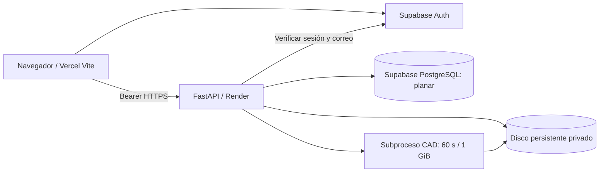

# Arquitectura de la beta

## Componentes y límites

La API no corre dentro de Vite ni como una función Vercel. Render usa un solo worker,
puerto `$PORT`, health check y un disco de 1 GB. El plan `standard` de la plantilla
es una propuesta para 2 GB de memoria; revisar el presupuesto vigente antes de crearlo.
El proceso CAD tiene 60 segundos de tiempo total, 60 segundos de CPU y 1 GiB de espacio
de direcciones en Linux. El proceso padre reserva memoria para API y cargas.
Se conservan los límites del motor: 20 MB, 40 000 triángulos, 250 paneles y 2000 contornos.
La biblioteca limita cada cuenta a 20 archivos / 100 MB y mantiene una reserva libre de 512 MB.

No se requieren Revit, Rhino completo, Blender, AutoCAD ni programas externos para los seis
formatos del motor actual. Las librerías Python tienen ruedas Linux instalables. `rhino3dm`
solo puede aprovechar las mallas guardadas en Brep; no se anuncia mallado NURBS general.
El nesting es heurístico por cajas; no garantiza un óptimo ni coloca piezas en agujeros.

## RVT y otros originales

RVT, IFC, DWG y SKP se aceptan en la biblioteca, con descargas privadas y aviso de conversión.
No se intentan interpretar como mallas ni se cobran créditos por almacenarlos. El despiece
rechaza esos formatos con HTTP 415. Ruta actual: exportar STL/OBJ o DXF desde el programa CAD.

Para RVT automatizado, conectar posteriormente Autodesk Platform Services Automation para
Revit, o un worker Windows con instalación/licencia compatible y cumplimiento de sus términos.
El proveedor Linux de esta beta no puede ejecutar una instalación de Revit de escritorio.
Esa integración necesita credenciales Autodesk, revisión de costes, validación por versión de
RVT y trabajos asíncronos; no está implementada ni anunciada como disponible.
Referencia: https://aps.autodesk.com/en/docs/design-automation/v3/developers_guide/overview/

## Persistencia y aislamiento

- Supabase Auth almacena contraseñas y confirma el correo. FastAPI consulta `/auth/v1/user`
  con el token del cliente; no confía en un JWT sin validar ni en el rol de metadatos editables.
- PostgreSQL usa el esquema privado `planar`. Siete tablas: users, files, jobs, subscriptions,
  credit_ledger, audit_log y admin_settings. No se expone este esquema mediante Data API.
- RLS está activado sin políticas de acceso de cliente y se revocan privilegios de `PUBLIC`,
  `anon` y `authenticated`. El aviso informativo del asesor «RLS enabled no policy» corresponde
  a denegación por defecto, intencional para tablas que solo consulta el backend.
  https://supabase.com/docs/guides/database/database-linter?lint=0008_rls_enabled_no_policy
- La conexión de servidor PostgreSQL debe ser secreta y tener privilegios de propietario del
  esquema. Se usa TLS; preferir el pooler de sesión Supabase, puerto 5432.
- Archivos con nombres UUID, ruta independiente del nombre original, tamaño limitado, extensiones
  permitidas y descarga `attachment`/`nosniff`. No se sirven como contenido HTML ni se ejecutan.
- Cada lectura, descarga y borrado comprueba `user_id`. Un administrador no obtiene una ruta
  de descarga global de originales por ser administrador.
- Los originales procesados desde Estudio no se archivan automáticamente. Para conservarlos,
  cargarlos en Archivos. Resultados y exportaciones del despiece sí son persistentes.
- Las transacciones reservan un crédito gratuito y lo devuelven al fallar. Tras reinicio se
  reembolsan trabajos interrumpidos una sola vez. Los datos de prueba no entran en producción.
- Logs estructurados con ID, ruta parametrizada, duración y estado; sin tokens, correos, nombres
  de archivos ni query strings. La plantilla desactiva access logs de Uvicorn.

## Modo comercial de prueba

Cinco créditos gratuitos de bienvenida por identidad verificada, sin recarga pública.
Los administradores pueden registrar hasta 100 créditos simulados por operación, con límite
acumulado de 1000 por cuenta. La clave de operación evita duplicar un reintento. La suscripción
simulada expira a los 14 días y puede cancelarse. El plan efectivo sigue siendo Gratis.

El procesador solo usa `free_credits`: jamás `trial_credits` ni `paid_credits`. `/api/checkout`
rechaza todos los cobros; `PAYMENTS_MODE` distinto de `disabled` impide iniciar cloud.
Ningún endpoint permite a usuarios concederse roles, créditos o un plan de pago.
El límite por cuenta debe complementarse con CAPTCHA, límites de Auth y monitorización
antes de una apertura amplia para reducir abuso mediante múltiples cuentas.

## Operación y escalado

Esta beta admite un único proceso API y una única operación CAD simultánea. No aumentar
workers o réplicas: la recuperación al inicio y el semáforo presuponen una instancia.
Render con disco no permite el mismo patrón de réplicas que un servicio sin estado y puede
presentar interrupciones durante despliegues. No se promete alta disponibilidad.

Para más volumen: Storage privado S3/Supabase, cola Redis o PostgreSQL, workers CAD separados,
leases de trabajos, límites por usuario y limpieza programada. La cola distribuida y la
conversión BIM son trabajo posterior. No se implementa análisis antimalware; se guardan
originales como datos opacos, nunca se renderizan automáticamente. Considerar escaneo antes
de compartir archivos con terceros.

Respaldar PostgreSQL y el disco por separado. Una prueba de restauración debe verificar también
la correspondencia entre metadatos y archivos. La beta no incluye una política automática de
retención de resultados ni servicio de copias independiente. Los usuarios pueden borrar sus
originales; la eliminación total de cuenta y su historial requiere operación administrativa
planificada antes de una disponibilidad comercial amplia.

## Alternativas de alojamiento

Render Free pierde escrituras al reiniciar y no admite disco persistente; además suspende
servicios inactivos. No es adecuado para esta implementación persistente.
https://render.com/docs/free · https://render.com/docs/disks

Railway, Fly.io o un VPS Linux pueden ejecutar esta API con PostgreSQL, volumen persistente,
TLS, límites de proceso y una sola instancia; requieren adaptar el manifiesto y verificar costes.
Como alternativa a Vercel, Render Static Sites admite la salida `frontend/dist` y una regla SPA;
su contratación y términos deben revisarse antes de adoptarlo. La configuración entregada
prioriza Vercel Pro, conforme a la solicitud.
