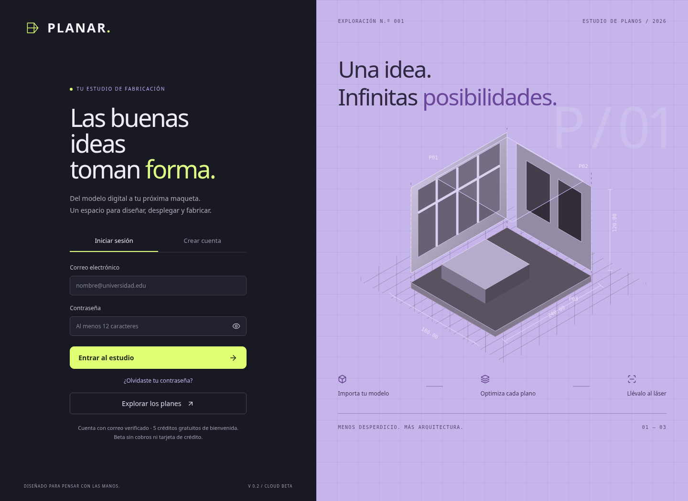
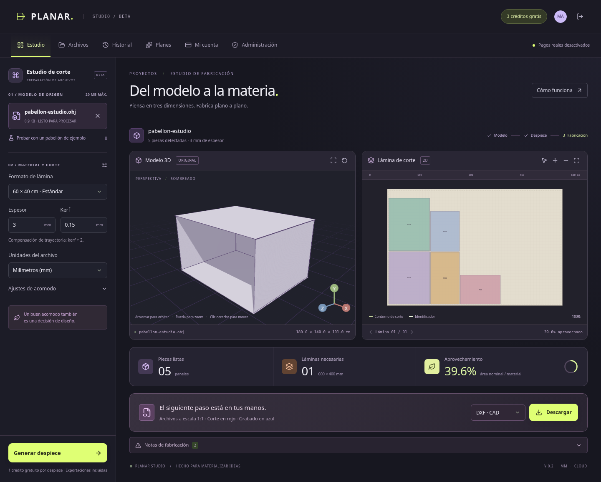
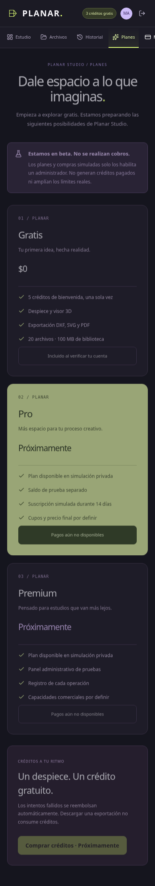

# Así quedó Planar Studio

Estas capturas muestran la versión 0.2 ejecutándose en el entorno de pruebas.
Puedes ver el diseño aquí mismo, sin instalar nada. Son imágenes de la aplicación;
esta página no es una instancia interactiva ni el despliegue de producción.

## Acceso y registro

## Estudio de fabricación

Modelo 3D, paneles, lámina de corte, aprovechamiento de material y descarga de archivos.
El ejemplo de la captura se procesó con el motor Python real. La identidad utilizada
para las pruebas fue simulada; no acredita inicio de sesión público con Supabase.

## Planes en móvil

Los pagos reales permanecen desactivados. Pro, Premium y los créditos de prueba
solo se simulan mediante la administración.

## Abrir la aplicación en tu PC

1. [Descarga el proyecto actualizado](https://github.com/mapb2830-collab/planar-local/archive/refs/heads/main.zip).
2. Extrae el ZIP en una carpeta nueva para conservar tus archivos anteriores.
3. Con Python 3.12 y Node.js 24 instalados, abre `INICIAR_WINDOWS.cmd`.
4. Cuando el lanzador termine y los servidores estén listos, abre
   [http://127.0.0.1:5173](http://127.0.0.1:5173).

Ese enlace local funciona después de iniciar el proyecto **en tu propio PC**.
Mantén abiertas las ventanas del backend y frontend mientras lo utilizas.
El modo local permite probar el estudio CAD sin cuentas reales; la biblioteca,
roles y planes cloud requieren el despliegue descrito en [DEPLOYMENT.md](DEPLOYMENT.md).

Las capturas corresponden al código `cae3c49`, validado el 9 de noviembre de 2026.
